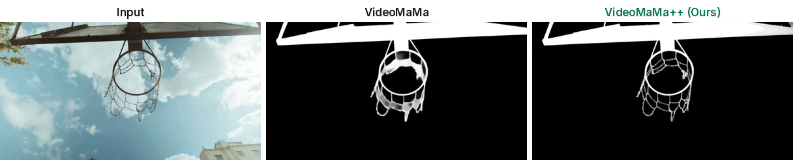
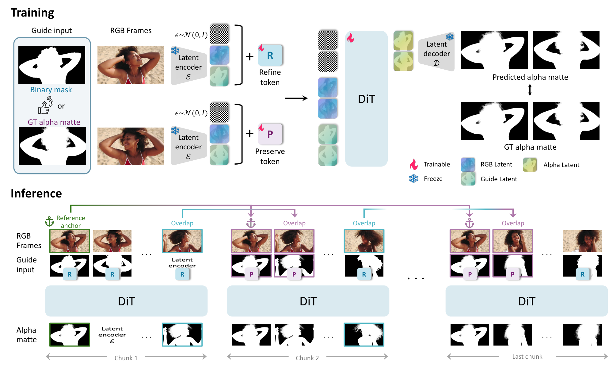

<div align="center">
<h1>VideoMaMa++: Temporally Consistent Video Matting via Preserve-and-Refine Tokens</h1>

[**Sangbeom Lim**](https://sangbeomlim.github.io/)<sup>1</sup> · [**Seoung Wug Oh**](https://sites.google.com/view/seoungwugoh/)<sup>2</sup> · [**Heeji Yoon**](https://yoon-heez.github.io/)<sup>3</sup>  
[**Seungryong Kim**](https://cvlab.kaist.ac.kr/members/faculty)<sup>3†</sup> · [**Joon-Young Lee**](https://joonyoung-cv.github.io/)<sup>2†</sup>

<sup>1</sup>Korea University&emsp;&emsp;&emsp;&emsp;<sup>2</sup>Adobe Research&emsp;&emsp;&emsp;&emsp;<sup>3</sup>KAIST AI  
<sup>†</sup>Co-corresponding authors

**NeurIPS 2026**

<a href="https://cvlab-kaist.github.io/VideoMaMa-PlusPlus/source/_NeurIPS_2026__LongMaMa.pdf"></a>
<a href="https://cvlab-kaist.github.io/VideoMaMa-PlusPlus"></a>
<a href="https://huggingface.co/spaces/SammyLim/VideoMaMa-PlusPlus"></a>
<a href="https://youtu.be/Az7E2s06HXQ"></a>

<strong>VideoMaMa++ is a mask-guided video matting framework built on a video diffusion transformer. Its preserve and refine tokens carry finished mattes across chunk boundaries, so long, in-the-wild videos stay temporally consistent without flickering at chunk seams.</strong>



For more visual results, check out our <a href="https://cvlab-kaist.github.io/VideoMaMa-PlusPlus">project page</a>.
</div>

## 📰 News
If you find our work helpful or impressive, please consider giving this repository a ⭐. It helps our research a lot!  
VideoMaMa++ is the follow-up to [VideoMaMa](https://github.com/cvlab-kaist/VideoMaMa) (CVPR 2026).

* **2026-10:** The [project page](https://cvlab-kaist.github.io/VideoMaMa-PlusPlus), this GitHub repository and the [online demo](https://huggingface.co/spaces/SammyLim/VideoMaMa-PlusPlus) are open!

## 🔥 TODO
- [x] Release the project page and paper.
- [x] Open the online demo.
- [ ] Release the model checkpoint. *(under review)*
- [ ] Release the inference and training code. *(under review)*

The code and model weights are under review before release. Until then, you can try VideoMaMa++ through the [online demo](https://huggingface.co/spaces/SammyLim/VideoMaMa-PlusPlus).

## 💡 Overview

<div align="center">

</div>

Video diffusion backbones can only process 6–24 frames at a time, so even ordinary videos are matted in chunks. When each chunk refines its coarse mask independently, neighbouring chunks settle on different refinements: flickering edges and jumps in transparency at every chunk boundary. VideoMaMa++ addresses this with two ideas:

- **Guidance as tokens.** RGB frames and the coarse mask enter the diffusion transformer as separate token streams, composed by full spatio-temporal self-attention instead of being fused by channel concatenation.
- **Preserve & refine tokens.** Two learnable embeddings tag every frame: *preserve* (keep this matte as a reference) and *refine* (turn this coarse mask into a fine matte consistent with the references).

At inference, a sliding window passes the matte already produced for the overlap frames to the next chunk under the preserve token, and a globally shared reference anchor is supplied to every chunk to stop errors accumulating over long videos, with no additional training.

VideoMaMa++ is built on Wan 2.1 (1.3B) adapted with LoRA and runs with a single denoising step at inference.

## 🎮 Demo
Try VideoMaMa++ on your own videos in the [Hugging Face demo](https://huggingface.co/spaces/SammyLim/VideoMaMa-PlusPlus). While the code and model are under review, the online demo is the way to run VideoMaMa++.

## 🎓 Citation
```bibtex
@inproceedings{lim2026videomamapp,
  title     = {VideoMaMa++: Temporally Consistent Video Matting via Preserve-and-Refine Tokens},
  author    = {Lim, Sangbeom and Oh, Seoung Wug and Yoon, Heeji and Kim, Seungryong and Lee, Joon-Young},
  booktitle = {Advances in Neural Information Processing Systems (NeurIPS)},
  year      = {2026}
}
```

If you use VideoMaMa++, please also consider citing VideoMaMa:
```bibtex
@inproceedings{lim2026videomama,
  title     = {VideoMaMa: Mask-Guided Video Matting via Generative Prior},
  author    = {Lim, Sangbeom and Oh, Seoung Wug and Huang, Jiahui and Yoon, Heeji and Kim, Seungryong and Lee, Joon-Young},
  booktitle = {Proceedings of the IEEE/CVF Conference on Computer Vision and Pattern Recognition (CVPR)},
  year      = {2026}
}
```

## 🙏 Acknowledgments
- **Wan 2.1**: the video diffusion transformer VideoMaMa++ builds on
- **SAM 3**: Meta AI's Segment Anything, used for the mask tracks in our comparisons
- **VideoMaMa**: our previous work and the starting point of this project

## 📧 Contact
For questions or issues, please open an issue on this repository.

We welcome any feedback, questions, or opportunities for collaboration. If you are interested in using this model for industrial applications, or have specific questions about the architecture and training, please feel free to reach out.

## 📄 License
This repository, including the code and model weights once released, is licensed under [CC BY-NC 4.0](https://creativecommons.org/licenses/by-nc/4.0/) unless otherwise specified. See [LICENSE](LICENSE).
